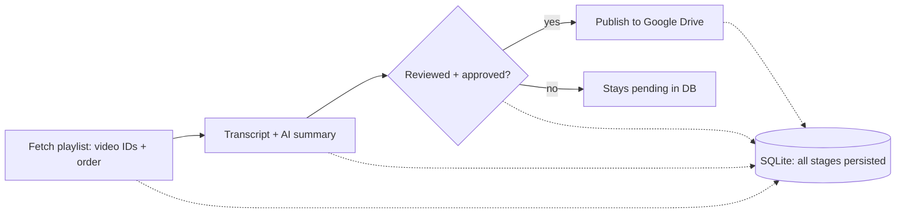

# Atlas – Product Requirements Document

Date: 2026-10-10 · Owner: Vikas Jaiswal

## 1. Overview & Goal

**Project name:** Atlas

**Owner:** Vikas Jaiswal (single user, personal tool)

**One-line goal:** Given a YouTube playlist link, Atlas automatically fetches every video in the playlist, generates detailed AI-powered learning notes for each video using an existing custom prompt, and assembles the result into a structured, skimmable "course" — one Google Doc per video plus an index Doc — inside a dedicated Google Drive folder per playlist.

**Why:** Vikas uses YouTube playlists (e.g. "Complete Java," "Complete Spring Boot") as a primary learning source but doesn't want to sit through hours of video. Atlas converts a playlist into readable, reference-grade course material he can skim or search, without re-watching content.

**Relationship to existing codebase:** Atlas is being rebuilt from scratch from an existing GitHub repo that already has working YouTube video/transcript/playlist fetching and an AI summarization integration for single videos. This rebuild extends that foundation into a full playlist-to-course pipeline with persistence, review, and Google Drive publishing.

## 2. Problem Statement

Learning a technical subject via YouTube playlists is time-expensive — a "Complete Java" or "Complete Spring Boot" playlist can run 100–250 videos. Watching linearly is slow, and there's no persistent, structured, skimmable artifact produced at the end. Vikas already has a prompt that turns one video's transcript into good personal-style notes, but there is no system to run that across an entire playlist, track progress, handle failures gracefully, let him review/edit before publishing, and organize the output into a durable, referenceable "course" in Google Drive.

## 3. Scope

**In scope (v1):**

- Accept one YouTube playlist URL at a time as input
- Fetch all video metadata (title, video ID, playlist order) for the playlist
- Fetch transcript for each video
- Generate AI notes per video using the existing custom prompt (provider: Gemini, swappable via config)
- Persist all playlist/video/transcript/summary state in a local database so no step is recomputed unnecessarily
- Frontend review UI: view, edit, and approve generated notes per video, plus a bulk "approve all" action
- On approval, create a Google Drive folder per playlist containing one Google Doc per video (numbered by playlist order) plus one index Doc listing video titles in order
- Status/progress dashboard: overall playlist progress, per-video pipeline stage, and failure reasons
- Automatic exponential-backoff retry for transient failures (e.g. rate limiting); manual retry button for all failures; permanent failures (e.g. no transcript available) fail fast with a visible reason, no auto-retry
- Incremental re-run of an already-processed playlist: detect and process only newly added videos, appended after existing ones (no renumbering of existing docs)
- Delete a playlist entirely; fully reprocess a playlist from scratch
- Manual transcript cleanup (delete stored transcript for a video/playlist on demand)

**Out of scope (v1 — future enhancements):**

- Multi-playlist queue / concurrent playlist processing
- Scheduling (e.g. auto-check a playlist for new videos on a timer)
- Cross-playlist/video search or topic search
- Authentication / multi-user support
- Cloud deployment (v1 runs on local machine only)
- Automatic detection of disguised IP-block errors (treated at face value for now)
- Renumbering existing docs when playlist order changes upstream

## 4. User & Use Case

**User:** Vikas only — single-user personal tool, no authentication needed in v1.

**Primary use case:** Vikas finds a long-form educational YouTube playlist (e.g. a complete Java course, a complete Spring Boot course — often 100–250 videos). He pastes the playlist link into Atlas. Atlas fetches every video, transcribes/summarizes each one into detailed personal-style notes, and Vikas reviews and approves the notes in the frontend. Approved notes are published as a numbered set of Google Docs in a dedicated Drive folder, giving him a skimmable, referenceable "course" he can study from instead of rewatching hours of video.

## 5. System Architecture & Pipeline Stages

**Pipeline overview:** Fetch playlist (video IDs + order) → Transcript + AI summary → Reviewed + approved? (gate) → Publish to Google Drive. SQLite persists all stages.

Every stage writes its result to the database before moving on, so any step can be safely re-run without redoing earlier work or burning API quota again.

**Stage 1 — Playlist ingestion.** Given a playlist URL, fetch and store metadata for every video: video ID, title, playlist position. This always runs first and is cheap (no AI, no transcript fetch).

**Stage 2 — Transcript & AI summary generation.** For each video (sequentially or in parallel, within rate limits), fetch its transcript, then run it plus Vikas's existing prompt through the configured LLM (Gemini) to produce detailed notes. Results are stored in the database as "pending review," not yet pushed anywhere.

**Stage 3 — Review & approval (frontend).** Vikas views each video's generated notes in the frontend, can edit the content inline, and approves it individually or in bulk ("approve all"). Only approved content proceeds.

**Stage 4 — Google Drive publish.** For a newly started playlist, create a new Drive folder named after the playlist. Create one Google Doc per approved video (filename starts with its playlist order number, followed by the video title) plus one index Doc (numbered list of video titles, created first/kept at the top) linking the course together.

## 6. Functional Requirements

**FR1 — Playlist input.** User submits a single YouTube playlist URL via the frontend.

**FR2 — Playlist ingestion.** System resolves the playlist, fetches the list of videos (ID, title, order), and persists them before any further processing begins.

**FR3 — Transcript fetch.** For each video, fetch its transcript. On permanent failure (no transcript available, video private/deleted/age-restricted/region-blocked), mark the video failed with a specific reason and do not auto-retry. On transient failure (rate limiting), retry automatically with exponential backoff.

**FR4 — AI note generation.** For each video with a transcript, run the existing custom prompt plus the transcript through the configured LLM (Gemini) to produce detailed, structured notes (headings, bullet points, distinct code-block styling for programming examples). Store the result as "pending review."

**FR5 — Review UI.** Frontend lists all videos in a playlist with their current stage/status. For videos with generated notes, user can view, inline-edit, and individually approve, or use "approve all" to bulk-approve everything generated so far.

**FR6 — Google Drive publish.** On approval, for a playlist being published for the first time, create a Drive folder named after the playlist. Create an index Google Doc (numbered list of video titles only) as the first/primary doc. For each approved video, create a Google Doc named `<order-number> <video title>`, containing the notes with a heading (video title + sequence number).

**FR7 — Status dashboard.** Real-time (or near-real-time) view of overall playlist progress and per-video pipeline stage (queued, fetching transcript, generating notes, pending review, approved, published, failed) with a visible, specific failure reason where applicable.

**FR8 — Retry.** Manual retry button available on any failed video. Automatic exponential-backoff retry applies only to transient failure types.

**FR9 — Incremental re-run.** Re-running an already-processed playlist re-fetches the current video list, diffs it against stored video IDs, and processes only newly found videos — appended after existing ones in both numbering and the index, with no recomputation of unchanged videos and no renumbering of existing Drive docs.

**FR10 — Playlist management.** User can delete a playlist (and its associated data) entirely, or trigger a full reprocess of a playlist from scratch.

**FR11 — Transcript cleanup.** User can manually clear/delete the stored raw transcript for a video or playlist once no longer needed, independent of the generated summary.

## 7. Data Model (outline)

SQLite, roughly normalized around four entities:

**Playlist** — id, source URL, title, Drive folder ID (once created), created_at, last_synced_at, status.

**Video** — id, playlist_id (FK), YouTube video ID, title, playlist order/position, pipeline stage, failure_type (nullable), failure_reason (nullable), retry_count, Drive doc ID (once created), created_at, updated_at.

**Transcript** — video_id (FK), raw transcript text, fetched_at, deleted flag/timestamp (for manual cleanup without losing the audit trail).

**Summary** — video_id (FK), generated notes content, model/provider used, generated_at, edited flag, approved flag, approved_at.

Pipeline stage (per video) is an explicit enum, e.g.: `queued → fetching_transcript → transcript_ready → generating_notes → pending_review → approved → published`, with a parallel `failed` state carrying a `failure_type` (`transient` | `permanent`) and `failure_reason` (free text, e.g. "TranscriptsDisabled", "rate_limited", "video_private").

## 8. Failure Handling & Status Taxonomy

Every failure is classified as either **transient** (auto-retried) or **permanent** (fails fast, shown with a reason, manual retry button only). v1 treats error types at face value — no attempt to detect a transient error (like an IP block) disguising itself as a permanent one.

**Transient (auto-retry, exponential backoff, then manual retry button if still failing):**

- API rate limiting / too many requests
- Temporary network or API errors

**Permanent (fail fast, no auto-retry, reason shown, manual retry button available):**

- Video is private
- Video was deleted by the uploader
- Video is age-restricted
- Video is region-blocked / geo-restricted
- Transcripts disabled by the uploader
- No transcript available in a usable language

Each video's failure state always shows a human-readable reason (not just "failed") so the status dashboard never leaves Vikas guessing, especially important given playlists can run 100–250 videos.

## 9. Incremental Sync / Re-run Behavior

When Vikas re-runs a playlist that's already been processed:

1. Fetch the current list of video IDs from YouTube for that playlist.
2. Diff against the video IDs already stored for that playlist in the database.
3. Existing videos (already fetched/summarized/published) are left untouched — no recomputation, no re-fetching, no wasted AI or transcript API calls.
4. New video IDs are inserted as new Video records, numbered continuing on from the highest existing order number (appended, not interleaved to match YouTube's current order).
5. Only the new videos go through the full pipeline (transcript → notes → review → approval → publish).
6. On publish, new videos' Docs are added to the existing Drive folder, and the index Doc is updated to append their titles — existing numbered Docs and index entries are not renamed or reordered.

This keeps re-runs cheap: cost scales with the number of *new* videos only, not the size of the whole playlist. Trade-off: if YouTube's own playlist order is later changed (videos reordered), Atlas does not reflect that — numbering reflects discovery order across runs, not live playlist order. This was a deliberate simplicity choice given reordering is rare on actively-maintained learning playlists.

## 10. Non-Functional Requirements

**Scale.** Must comfortably handle playlists of 100–250 videos without the UI or database becoming unusable; per-video processing should be parallelizable within API rate limits rather than strictly sequential, to keep large playlists from taking unreasonably long.

**Idempotency.** No step is ever recomputed unless explicitly triggered (manual retry, or a deliberate full reprocess) — this is a core cost-control requirement given AI and transcript API usage is metered.

**Observability.** The status dashboard is a first-class requirement, not an afterthought — given playlist sizes, Vikas must never be left wondering what's happening or why something failed.

**Data integrity.** Nothing is pushed to Google Drive unless explicitly approved in the frontend, to avoid dirty/incomplete data landing in Drive.

**Resilience.** Transient failures must not require manual intervention by default (exponential backoff); permanent failures must not retry indefinitely and waste quota.

**Portability of the AI layer.** The AI provider/model must be configurable, not hardcoded, since the underlying prompt is provider-agnostic.

**Simplicity.** Explicitly no auth, no multi-user support, no cloud deployment, no scheduler, and no multi-playlist queue in v1 — these are deferred, not designed around.

## 11. Tech Stack

- **Language/runtime:** Python (existing codebase language)
- **Frontend:** Existing frontend (framework TBD/kept from current repo), extended with the review UI, status dashboard, and playlist input
- **Database:** SQLite (local, zero-setup, sufficient for single-user local use; migration to Postgres is a future option if ever deployed to a server)
- **YouTube data & transcripts:** Existing integration from the current repo (reused/ported into the rebuild)
- **AI/LLM:** Gemini (API key already available), kept swappable via configuration
- **Google Drive integration:** New — Drive API (folder creation per playlist, Google Docs creation per video + index), including auth/credentials setup
- **Deployment:** Local machine only for v1; no containerization or cloud hosting required at this stage

## 12. Build Sequence / Milestones

Sequenced by dependency — each stage builds on data/behavior the previous one provides:

**M1 — Playlist ingestion & persistence.** Port/adapt existing YouTube integration to fetch full playlist video lists; design and stand up the SQLite schema; store playlist + video metadata. Done when: submitting a playlist URL reliably populates the database with every video's ID, title, and order.

**M2 — Transcript & AI summary pipeline.** Wire transcript fetching and the existing prompt + Gemini into a per-video pipeline stage; implement the permanent-vs-transient failure classification and exponential backoff retry. Done when: a playlist's videos each reach "pending review" (or a clearly-reasoned failed state) without manual intervention.

**M3 — Review UI & status dashboard.** Build the frontend views for per-video and per-playlist status, inline editing of generated notes, individual and bulk approval, and manual retry. Done when: Vikas can watch a playlist process end-to-end, understand every state, edit content, and approve it.

**M4 — Google Drive integration.** Build Drive folder-per-playlist creation, per-video numbered Doc creation, and the index Doc, triggered only by approval. Done when: approving videos in the UI reliably produces a correctly named, correctly structured Drive folder.

**M5 — Incremental re-run & playlist management.** Implement the diff-based re-run logic (fetch → compare → process only new), plus playlist delete and full-reprocess actions. Done when: re-running a previously completed playlist only touches new videos, and delete/reprocess work as expected.

**M6 — Hardening.** Transcript cleanup action, exponential backoff tuning, edge-case testing on a few real large (100+) playlists.

## 13. Open Questions & Assumptions

- **Parallelism:** Exact concurrency level for processing videos within a playlist (sequential vs. N-at-a-time) is not yet decided — will depend on Gemini and transcript-fetch rate limits observed during M2.
- **Google Drive auth:** Assumes a personal Google account with Drive API access/OAuth credentials will be set up as part of M4; specific auth flow (service account vs. OAuth user flow) not yet decided.
- **Frontend framework:** Assumed to be whatever the existing repo already uses; not re-decided here.
- **Prompt reuse:** Assumes Vikas's existing single-video prompt can be reused as-is inside the pipeline without modification; may need minor adjustment to fit the per-video Doc format (headings, code blocks).
- **Video order appending:** Assumes YouTube playlist reordering is rare enough that always appending new videos (rather than reflecting live reordering) is an acceptable permanent trade-off, not just a v1 simplification.

## 14. Success Criteria

Atlas v1 is successful if:

- Vikas can paste a YouTube playlist link (including a 100–250 video playlist) and the system processes it end-to-end without manual babysitting beyond review/approval.
- He always has a clear, specific answer to "what's happening right now, and what failed and why" via the status dashboard.
- No AI or transcript API call is ever repeated for a video that's already been successfully processed.
- The final Google Drive output — one folder per playlist, a numbered index Doc, and numbered per-video Docs — is clean, correctly ordered, and lets him skim/reference a whole playlist's worth of learning without rewatching any video.
- Re-running a playlist to pick up newly added videos is fast and cheap, touching only the new videos.

## 15. Pipeline State Machine & Processing Rules

Each video moves through the stages in Section 7. These rules make the pipeline safe to stop, crash and resume.

- **Allowed transitions:** queued → fetching_transcript → transcript_ready → generating_notes → pending_review → approved → published. Any active stage can move to failed. failed returns to queued only through a retry (automatic for transient, manual otherwise).
- **Persist before and after side effects:** a stage is written to the database before the external call starts and again when it finishes, so progress is never lost.
- **Skip completed work:** before running a stage, check whether its output already exists (transcript row, summary row, Drive doc ID). If it does, skip the stage. This is what enforces the no-recompute rule.
- **Crash recovery:** on backend startup, any video left in fetching_transcript or generating_notes is reset to the last stable stage and re-queued.
- **Idempotent publishing:** the Drive doc ID is saved immediately after a Doc is created. A retried publish updates the existing Doc rather than creating a duplicate.
- **Edits after approval:** editing a published summary marks the video as changed and offers a "re-publish" action that updates the existing Doc in place.
- **Regenerate:** a manual "regenerate notes" action reuses the stored transcript, asks for confirmation, and overwrites the previous summary.

## 16. Backend API Contract (outline)

A JSON REST API between frontend and backend. Exact paths can adapt to the existing framework; the capabilities are what matter.

- **POST /playlists** — submit a playlist URL; validates it, ingests metadata, returns the playlist record. Submitting an already-known URL triggers the incremental re-run instead of a duplicate.
- **GET /playlists** and **GET /playlists/{id}** — list playlists; one playlist with overall progress counts per stage.
- **GET /playlists/{id}/videos** — videos with stage, failure type and reason, filterable by stage.
- **POST /playlists/{id}/process** — start or resume the pipeline for queued videos.
- **POST /playlists/{id}/reprocess** and **DELETE /playlists/{id}** — full reprocess from scratch; delete with all stored data (confirmation required in the UI).
- **GET /videos/{id}/summary** and **PUT /videos/{id}/summary** — read and save inline edits.
- **POST /videos/{id}/approve** and **POST /playlists/{id}/approve-all** — approve one or all videos that are pending review.
- **POST /videos/{id}/retry** and **POST /videos/{id}/regenerate** — manual retry; regenerate notes.
- **POST /playlists/{id}/publish** — publish approved videos to Drive.
- **DELETE /videos/{id}/transcript** and **DELETE /playlists/{id}/transcripts** — manual transcript cleanup.
- **Conventions:** consistent error body (code, message, details), proper HTTP status codes, long-running work returns immediately and runs in a background worker, and the frontend polls status (no websockets in v1).

## 17. Configuration, Secrets & Environment

- All settings come from environment variables or a local .env file; a committed .env.example documents every key with no real values.
- **Settings:** Gemini API key and model name, prompt file path, database path, max concurrent videos, retry limits and backoff base/cap, Google OAuth credentials path and token path.
- **Secrets hygiene:** .env, OAuth client secret and the stored token file are listed in .gitignore and never committed. Logs never print keys, tokens or full transcripts.
- **Setup:** the README gives a one-time setup (install, create .env, run migrations, complete the Google consent flow once) and a single command to start backend and frontend.

## 18. AI Notes Generation Spec

- **Prompt as a file:** the existing prompt lives in a versioned file in the repo, not inline in code. Each summary records the prompt version and model used.
- **Output format:** the model returns structured Markdown: a title line, headings, bullets, and fenced code blocks tagged with a language. The Drive publisher converts this into Google Docs formatting, with code blocks in a visually distinct (shaded, monospace) box.
- **Output validation:** reject empty or malformed responses and retry them as transient failures, within the retry limit.
- **Long transcripts:** a 1–2 hour video can produce a very long transcript. The system checks transcript size against the model's input limit; if it does not fit, it fails that video with a clear reason rather than silently truncating. Chunk-and-merge is a later enhancement.
- **Safety of repeated runs:** a summary is generated at most once per video unless regenerate or reprocess is explicitly triggered.

## 19. Google Drive Publishing Spec

- **Access:** OAuth user flow with the narrowest scopes that work (files created by the app, plus Docs editing). Consent is done once; the token is stored locally and refreshed automatically.
- **Structure:** one folder per playlist named after the playlist, holding the index Doc and one Doc per video. Folder and Doc IDs are stored in the database at creation time.
- **Naming:** each Doc is named with its playlist order number, a separator and the video title. Titles are sanitized for characters Drive handles poorly. Order numbers are zero-padded to the width of the playlist size so Drive sorts them correctly (see Section 24).
- **Doc content:** heading with the video title and sequence number, then the formatted notes. No video link or duration, per the requirements.
- **Index Doc:** a numbered list of video titles only, first in the folder, updated by appending when new videos are published.
- **Rate limits and failures:** Drive and Docs calls use the same exponential backoff as other transient failures. A publish that fails halfway is safe to re-run because already-created Docs are detected by stored IDs.
- **Publish order:** folder, then index Doc, then video Docs in playlist order.

## 20. Edge Cases & Boundary Behavior

- **Invalid or unsupported URL:** rejected with a clear message before anything is stored (accepts playlist links, with or without extra query parameters).
- **Private or unavailable playlist:** fails at ingestion with a visible reason; nothing is created in Drive.
- **Duplicate video within a playlist:** stored once per playlist position but processed once; the second occurrence reuses the first summary.
- **Same video in different playlists:** treated independently in v1, so a transcript may be fetched again. Cross-playlist reuse is future work.
- **Video removed from the playlist upstream:** on re-run it is kept as is (no deletion from the database or Drive) and flagged as "no longer in playlist" in the dashboard.
- **Renamed video upstream:** existing titles are not updated on re-run; only new videos are added.
- **Non-English or auto-generated transcript:** used as is, with the language recorded; the prompt handles it.
- **Backend restart mid-run:** handled by crash recovery in Section 15.
- **Very large playlist (250+):** ingestion stores everything first; processing proceeds in controlled concurrency so memory and rate limits stay in bounds.

## 21. Testing & Engineering Standards

- **Layering:** separate API handlers, service logic (pipeline, retry, sync diffing), repositories (database access) and integrations (YouTube, Gemini, Drive). Integrations sit behind interfaces so they can be mocked and swapped, which is also how provider portability is achieved.
- **Database changes:** schema managed through migrations, not ad hoc scripts. Unique constraints on (playlist, YouTube video ID), and indexes on playlist and stage for dashboard queries.
- **Tests:** unit tests for failure classification, retry/backoff, incremental diffing and state transitions; integration tests against a temporary SQLite database with YouTube, Gemini and Drive mocked; one manual end-to-end run per milestone against a small real playlist.
- **Code quality:** type hints, a linter and formatter configured in the repo, small functions, no hardcoded secrets or magic numbers (limits come from config).
- **Logging:** structured logs with playlist and video IDs on every pipeline event; errors include the classified failure type.
- **Docs and hygiene:** README with setup and run steps, .env.example, and a .gitignore covering secrets and the local database file.
- **Backups:** the SQLite file holds the only copy of transcripts and unpublished edits, so a simple copy-the-file backup step is documented.

## 22. Acceptance Criteria per Milestone

- **M1:** a 100+ video playlist is stored completely with correct order; resubmitting does not create duplicates.
- **M2:** a forced rate-limit error is retried with backoff and then succeeds or fails visibly; a video with no transcript fails immediately with a reason and no retries; restarting mid-run loses no completed work.
- **M3:** every video shows an accurate stage; an edit survives a page reload; approve-all approves only videos that are pending review.
- **M4:** nothing reaches Drive before approval; names and numbering are correct; running publish twice creates no duplicates; code blocks render in the distinct styled box.
- **M5:** adding videos to a test playlist and re-running touches only those; delete and reprocess leave no orphaned data.
- **M6:** a full 150+ video run completes with every failure explained and no unnecessary repeated API calls.

## 23. Risks & Mitigations

- **YouTube blocks or throttles transcript requests (especially on long runs):** low default concurrency, backoff, and the manual retry path; spreading a large playlist over more than one session is acceptable.
- **Gemini rate limits or cost on large playlists:** concurrency cap in config, no recomputation, and processing in batches with the status dashboard showing progress.
- **Notes quality varies across videos:** mandatory manual review before publish, plus regenerate.
- **Drive formatting limits (code blocks):** validate the Docs formatting approach early in M4 with a single sample before building the rest.
- **Local-only data loss:** documented backup of the database file.
- **Prompt not fitting the new pipeline:** versioned prompt file makes adjustments safe and traceable.

## 24. Proposed Defaults to Confirm

These are recommended defaults, added so implementation is not blocked. Change any you disagree with.

- Zero-pad order numbers in Doc names so Drive sorts them correctly.
- Default concurrency of 2–3 videos at a time, configurable.
- Editing a published note offers an explicit re-publish that updates the existing Doc.
- Videos removed from a playlist upstream are kept and flagged, never deleted automatically.
- If the existing repo has no backend framework, use FastAPI; otherwise keep the current one.
- Frontend polls for status instead of using websockets.
