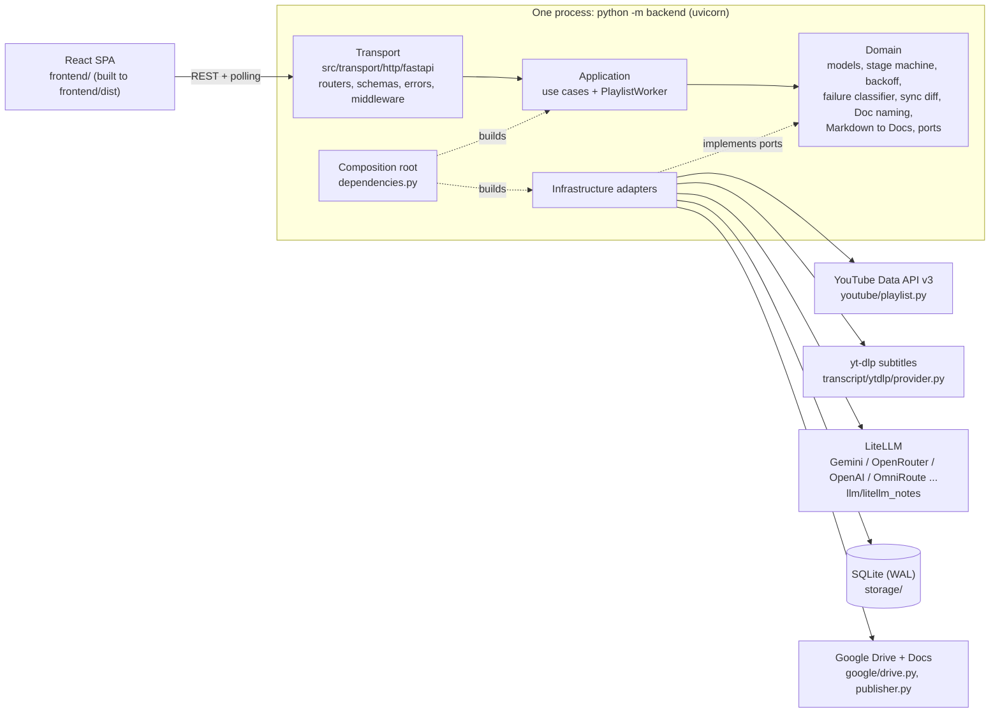
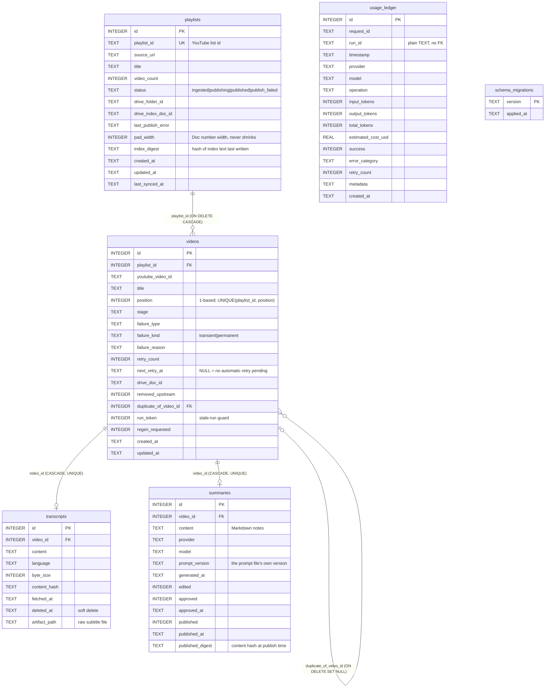
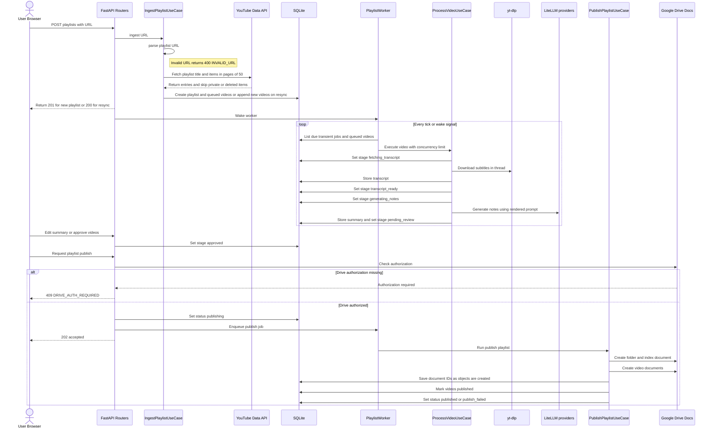
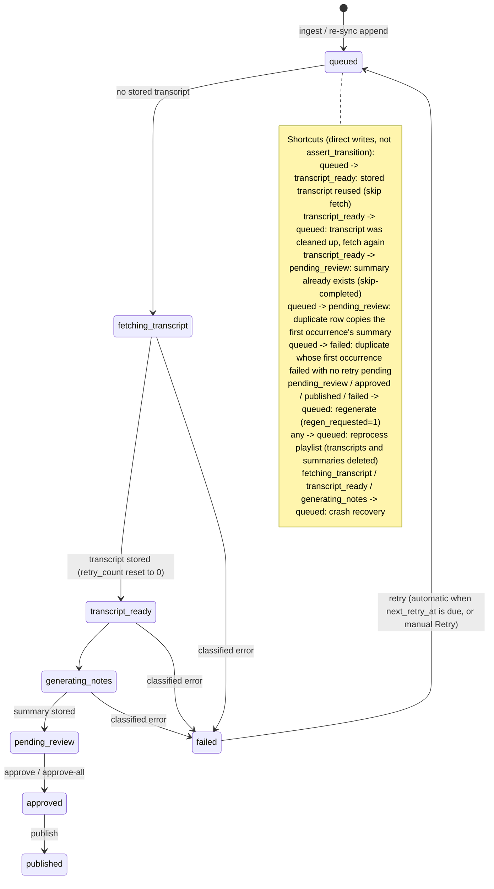
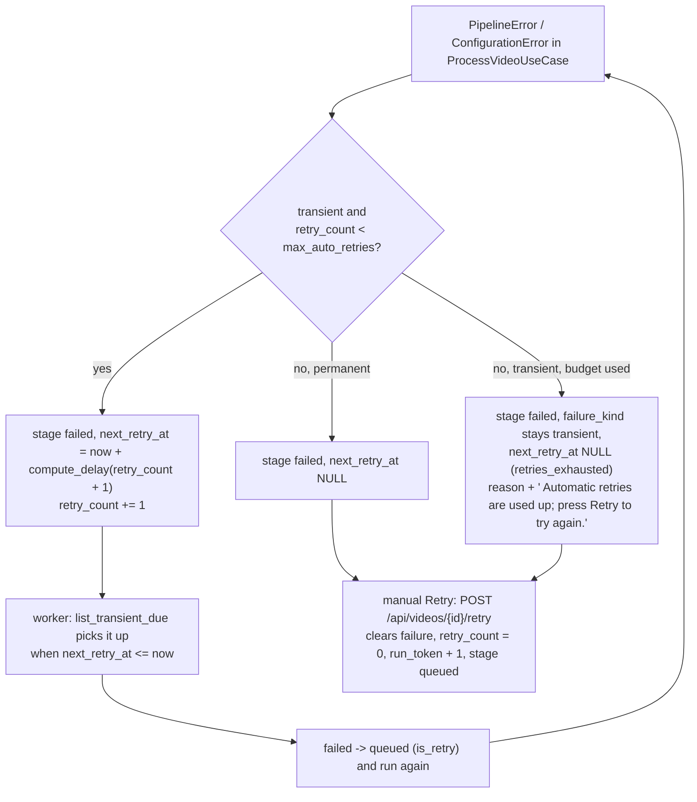
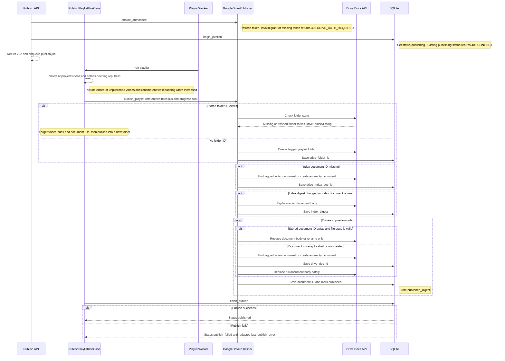

# Atlas architecture

This describes the code as it is. Requirements live in [`Atlas_PRD.md`](Atlas_PRD.md), UI rules
in [`design.md`](design.md), settings in [`CONFIG.md`](CONFIG.md), failure recipes in
[`TROUBLESHOOTING.md`](TROUBLESHOOTING.md).

Atlas is a local, single-user tool: one Python process (FastAPI + a background worker) and one
SQLite file. A YouTube playlist becomes one Google Doc of LLM-written notes per video plus an
index Doc, in one Drive folder, after a human has reviewed and approved each note.

## 1. Components and layers



| Layer | Path | What it owns |
|---|---|---|
| Transport | `src/transport/http/fastapi/` | Routers (`playlists`, `videos`, `drive_auth`, `usage`), Pydantic schemas, the `{code, message, details}` error envelope (`errors.py`), request logging with `X-Correlation-ID` (`middleware.py`). |
| Composition root | `src/transport/http/fastapi/dependencies.py` | The only module that knows both ports and adapters. Builds everything lazily, so the app starts without any API key; a missing key surfaces as `ConfigurationError` (HTTP 503 `CONFIG_MISSING`) when the feature is used. |
| Application | `src/application/` | `IngestPlaylistUseCase`, `ProcessVideoUseCase`, `PublishPlaylistUseCase`, the user actions in `actions.py` (approve, approve-all, edit, retry, regenerate, reprocess, delete, transcript cleanup) and `PlaylistWorker`. Depends only on ports. |
| Domain | `src/domain/` | `Playlist`, `Video`, `Transcript`, `Summary`, `Stage`, `FailureType`/`FailureKind` (`models/playlist.py`); pure services (`stage_machine`, `backoff`, `failure_classifier`, `sync_diff`, `playlist_url`, `doc_naming`, `markdown_to_docs`); ports in `interfaces/`. |
| Infrastructure | `src/infrastructure/` | `youtube/playlist.py` (playlist listing), `transcript/ytdlp/provider.py`, `llm/` (`litellm_notes.py` single LiteLLM adapter, `models.py` model list, `factory.py`, cost table), `storage/` (connection + migration runner, `PlaylistRepository`, `SqlUsageLedger`), `google/` (`GoogleDriveExporter` for OAuth and raw API calls, `GoogleDrivePublisher` for idempotent publishing). |
| Entry points | `backend/__main__.py`, `backend/main.py`, `backend/spa.py`, `backend/services/diagnostics.py` | Startup checks (config, port), the FastAPI app and lifespan, serving `frontend/dist` with an SPA fallback, `GET /api/diagnostics`. |
| Config / shared | `src/config/settings.py`, `src/configs/config.yaml`, `src/prompts/`, `src/shared/` | `AtlasSettings` (see CONFIG.md), versioned prompt files, logging, secret redaction, file helpers. |

Ports (`src/domain/interfaces/`): `PlaylistProviderPort`, `TranscriptProviderPort`,
`NotesGeneratorPort`, `PlaylistRepositoryPort`, `DrivePublisherPort`, `UsageLedgerPort`.

**Single owner of retries.** Adapters make one provider call and raise a classified error
(yt-dlp runs with `retries: 0`; LiteLLM is called with `num_retries=0`).
`ProcessVideoUseCase` decides whether and when to retry and persists that decision, so retries
survive a restart and are bounded. The one exception is Drive: `GoogleDrivePublisher` retries
each Drive/Docs call in place (section 5).

## 2. Data model

Migrations are numbered SQL lists in `src/infrastructure/storage/migrations.py`, applied in one
transaction each by `storage/db.py::initialize` when the repository is first built (app
startup), and recorded in `schema_migrations`. Migration `0003` drops the legacy search-run
tables; `0004` rebuilds `videos` (with foreign keys off) to one row per playlist position.
Before the first pending migration on a database that already has migrations applied, a copy
is written to `<db>.pre-<version>.bak`.

Final schema (verified by migrating an empty database):



`usage_ledger` also has `currency`, `latency_ms`, `cache_hit`, `cache_key`, `cache_namespace`
(kept from migration 0002).

Indexes: `idx_playlists_created(created_at)`; `idx_videos_playlist_stage(playlist_id, stage)`,
`idx_videos_youtube(playlist_id, youtube_video_id)`, `idx_videos_duplicate_of(duplicate_of_video_id)`;
`idx_transcripts_video(video_id)`; `idx_summaries_video(video_id)`; `idx_usage_timestamp`,
`idx_usage_provider`, `idx_usage_model`, `idx_usage_operation`, `idx_usage_run_id`,
`idx_usage_request_id`. Unique constraints: `playlists.playlist_id`,
`videos(playlist_id, position)`, `transcripts.video_id`, `summaries.video_id`.

Why these shapes:

- **One row per position.** A video that appears twice in a playlist gets two rows; the second
  has `duplicate_of_video_id` set and receives a copy of the first occurrence's summary instead
  of being processed again, so Doc numbering matches YouTube.
- **`run_token`.** Retry, regenerate and reprocess bump it. Every write of a running task carries
  the token it started with; a mismatch raises `StaleRunError` and the stale result is dropped.
- **`removed_upstream`.** A re-sync never deletes rows: a video gone from YouTube is flagged and
  skipped by the worker; it is cleared if the video reappears.
- **`published_digest`.** Lets the UI show "edited since publishing" and lets publish decide
  whether a published Doc needs rewriting.

## 3. End-to-end flow



Every stage is written before and after its side effect, so a crash leaves a stage that crash
recovery understands (section 6). Re-submitting a known playlist URL re-syncs: existing rows
keep their stage and position, new videos are appended after the current maximum position.

## 4. Per-video state machine

`src/domain/services/stage_machine.py` defines the strict edges that `assert_transition`
checks. `failed -> queued` is allowed only with `is_retry=True`. Same-stage writes are always
allowed. Several moves are deliberate shortcuts written directly through
`PlaylistRepository.update_stage` (or a dedicated repository method) without
`assert_transition`; they are dashed below.



Notes on the shortcuts:

- **Regenerate** (`POST /api/videos/{id}/regenerate`) is allowed from `pending_review`,
  `approved`, `published` and `failed` (`REGENERATE_FROM`). The video is re-queued with
  `regen_requested=1`; the worker reuses the stored transcript (or re-fetches it), generates new
  notes, then `repo.regenerate` overwrites the summary, clears approval and publish flags,
  keeps `drive_doc_id` and writes `pending_review`.
- **Duplicates** are only picked up once their first occurrence is `pending_review`, `approved`,
  `published`, or `failed` with `next_retry_at IS NULL`. A duplicate marked failed gets the
  reason "Same video as #N, which failed: ..."; Retry on it re-checks.
- **Edits** (`PUT /api/videos/{id}/summary`) are allowed in `pending_review`, `approved` and
  `published` and do not change the stage; they set `summaries.edited`.
- The worker never processes rows with `removed_upstream = 1`; Retry and Regenerate refuse them.

## 5. Failures and retries

### Classification

Every failure is a `FailureType` with a fixed `FailureKind` (`FAILURE_KINDS` in
`models/playlist.py`):

| Kind | Types | Behaviour |
|---|---|---|
| transient | `rate_limited`, `network_error`, `provider_error`, `output_malformed`, `drive_error` | Retried automatically with backoff (video types) or in place (Drive). |
| permanent | `video_private`, `video_deleted`, `age_restricted`, `region_blocked`, `members_only`, `transcripts_disabled`, `no_usable_language`, `transcript_too_large`, `config_error`, `internal_error`, `playlist_unavailable`, `invalid_url` | Failed at once with a readable reason; only a manual action helps. |

Where the type comes from:

- **Subtitle track choice.** The yt-dlp adapter requests `[<lang>-orig, ..., <lang>, en]` in one
  call. YouTube serves the original auto-caption (`en-orig`) but often answers the plain derived
  track (`en`) with HTTP 429; yt-dlp writes tracks in order, so a subtitle file already on disk
  when a later track fails is used and the error is only logged at debug level. With no file on
  disk the error is classified as below. A `<lang>-orig` file is recorded as `<lang>`.
- **yt-dlp** errors go through `failure_classifier.classify_transcript_error`: ordered regex rules,
  first match wins. Rate limiting (`HTTP Error 429`, "too many requests", "rate-limited",
  "try again later") is checked first because a throttled IP gets "Video unavailable ... try
  again later", which would otherwise read as a deleted video. Anything unrecognised is
  `provider_error` (transient).
- **LLM** errors go through `notes_base.classify_provider_exception`: rejected key (401/403, or
  key-invalid text such as Gemini's HTTP 400 `API_KEY_INVALID`), 402 and 404 become
  `NotesGeneratorConfigError` (recorded as permanent `config_error`); "prompt too long" text is
  `transcript_too_large`; 429 is `rate_limited`; 5xx is `provider_error`; content-filter text is
  `output_malformed`; timeouts and connection errors are `network_error`. A missing key or
  prompt file is also a `config_error`. Before calling, `check_input_size` estimates tokens as
  characters / 4 and refuses a transcript over the model's `input_token_limit`
  (`transcript_too_large`, never truncated; the next configured model is tried instead).
  LiteLLM raises OpenAI-style exceptions; the classifier reads their status code and class name
  (`ContextWindowExceededError`, `ContentPolicyViolationError`, `APIConnectionError` / `Timeout`).
- **Multiple API keys**: `src/shared/api_keys.py` parses a comma-separated / numbered list per
  service into a thread-safe `KeyPool` (round-robin, per-key cooldown, disable). The YouTube
  provider (`_execute`) and the LLM adapter (`notes_base.call_with_keys`, once per configured
  model) fail over to the next key on a key-scoped error (quota, 429, rejected key, 402) and
  re-raise anything else. When a model is turned away entirely, `LiteLLMNotesGenerator` falls
  back to the next model in `notes_models`.
  Output checks (`validate_notes`, `check_finish_reason`) raise `output_malformed` for empty,
  too-short, section-less, cut-off or blocked responses.
- Any other exception in `ProcessVideoUseCase` is a permanent `internal_error` (traceback logged).

### Automatic retry with backoff



`src/domain/services/backoff.py::compute_delay(attempt, base, cap, jitter_ratio=0.2)`:

```
delay = min(cap, base * 2 ** (attempt - 1))
delay += uniform(0, 0.2 * delay)        # jitter, so the result can exceed cap by up to 20%
```

With the defaults (`backoff_base_seconds: 5`, `backoff_cap_seconds: 300`) the waits before
automatic retries 1-4 are about 5, 10, 20 and 40 seconds (each plus up to 20%). The delay is
persisted as `next_retry_at` (UTC ISO timestamp), so a restart keeps the schedule.

A rate-limited **YouTube transcript fetch** (`rate_limited` while the video is in
`fetching_transcript`) uses its own, longer policy: `rate_limit_backoff_base_seconds: 60`,
`rate_limit_backoff_cap_seconds: 900`, `rate_limit_max_auto_retries: 6`, because throttles last
minutes. A rate-limited LLM call keeps the regular policy above. The yt-dlp adapter also
serializes fetches behind one lock, spaced `transcript_min_interval_seconds` apart.

**Per-phase budget.** `retry_count` is reset to 0 when the transcript is stored
(`update_stage(..., reset_retries=True)`), so the notes phase starts with a full
`max_auto_retries` budget instead of inheriting what YouTube throttling used up. Each phase
therefore makes at most `1 + max_auto_retries` attempts. An exhausted transient failure has
`next_retry_at IS NULL` and is never picked up again by `list_transient_due`; the API exposes
this as `retries_exhausted: true` and `auto_retry: false`.

**Drive retries** are separate and in place: `GoogleDrivePublisher._retry_call` retries HTTP
429, 5xx, 403 with `rateLimitExceeded`/`userRateLimitExceeded`, network errors and retryable
token-refresh errors up to `drive_max_retries` times (default 3, so up to 4 attempts per call),
with `compute_delay(attempt, drive_backoff_base_seconds, drive_backoff_cap_seconds)`. A
permanent refresh failure (`invalid_grant`) raises `DriveAuthorizationRequired` immediately.
Anything else fails the publish with a redacted `drive_error` reason.

## 6. Publishing to Google Drive


Idempotency and resume:

- **Ids are persisted the moment each object exists** (progress sink), before anything else can
  fail. A failed publish is resumed by publishing again: stored ids are reused, nothing is
  created twice.
- **Create and format are separate retried steps.** A failure while writing a Doc's content
  leaves a Doc whose id is already stored; the next attempt updates it.
- **Private tags cover lost responses.** Every created object carries `appProperties`
  (`atlasKind`, `atlasPlaylist` / `atlasVideo`). On a retry of a create (and on the first attempt
  for Docs) the publisher searches for the tagged object and adopts it instead of creating a
  duplicate. The folder's first attempt does not search, so a new playlist never adopts the
  folder of a deleted playlist that had the same database id.
- **Re-publish in place.** Reprocess and regenerate keep `drive_folder_id`,
  `drive_index_doc_id` and `drive_doc_id`, so the next publish rewrites the same Docs.
- **Deleted in Drive.** A stored folder that is missing or trashed makes the whole playlist
  publish again into a new folder (only approved/published videos qualify). A stored video Doc
  that is missing or trashed is re-created. The stored index Doc is not state-checked.
- **Naming.** `doc_naming.doc_name`: the 1-based position zero-padded to the digit count of the
  largest position (`7 - Title` in a 9-video playlist, `07 - Title` with 12 videos,
  `007 - Title` with 120), and the same text as Heading 1 in the Doc.
  The width is stored in `pad_width` and never shrinks; when it grows, already-published Docs
  are renamed (padding only).
- **Remaining window.** Between Drive returning a new id and the database write there is a short
  window; a crash there is covered for Docs by the tag search, not for the folder.
- **Background run.** `run()` never raises; the playlist ends `published` or `publish_failed`.
  One publish per playlist runs at a time (`begin_publish` is an atomic conditional update and
  the worker tracks running publishes).

## 7. Startup and crash recovery

`python -m backend` (`backend/__main__.py`):

1. `load_settings()` validates `config.yaml` and the environment; on any problem it prints the
   list and exits with status 2.
2. `port_problem()` binds a probe socket (with `SO_EXCLUSIVEADDRUSE` on Windows); if the port is
   taken it prints one line and exits with status 1. `--check` stops here and prints
   "Configuration OK; ... is free."
3. Logging is configured and uvicorn starts `backend.main:app`. On import, `backend.main`
   validates settings again and configures logging; the lifespan builds the usage ledger and
   repository (which runs pending migrations) and starts the worker.

`PlaylistWorker.start()`:

- `recover_in_flight_videos()` moves every `fetching_transcript`, `transcript_ready` and
  `generating_notes` row to `queued` and logs "Crash recovery reset N in-flight videos to
  queued". Stored transcripts and summaries are reused (skip-completed), so finished work is not
  redone.
- Playlists left `publishing` are re-queued for publish ("Crash recovery re-queued an
  interrupted publish"); publishing is idempotent, so resuming is safe.
- Failed videos with a future `next_retry_at` keep their schedule.

Shutdown (Ctrl+C / SIGTERM): the lifespan calls `worker.stop()`, which cancels the loop, waits up
to `worker_shutdown_timeout_seconds` for running jobs and cancels the rest; their videos are
recovered on the next start.

## 8. Concurrency model

- **One process, one event loop.** The worker runs inside the uvicorn process as asyncio tasks
  (`backend/main.py` lifespan). There is no separate worker process or queue service.
- **Bounded video work.** At most `max_concurrent_videos` `ProcessVideoUseCase` tasks run at
  once. The loop wakes on `worker.wake()` (new playlist, retry, regenerate, a finished task) or
  every `worker_poll_interval_seconds`. Due transient retries are dispatched before queued
  videos. Publish jobs are separate tasks, not counted against `max_concurrent_videos`.
- **Blocking work in threads.** SQLite access, yt-dlp, the YouTube Data API client and every
  Drive/Docs call run in `asyncio.to_thread`. The LLM SDKs are called through their async
  clients. The interactive OAuth consent runs in a thread behind a lock (one consent at a time,
  5-minute timeout), so the API stays responsive while it waits for the browser.
- **SQLite.** Each repository call opens its own connection with `journal_mode=WAL`,
  `foreign_keys=ON` and `busy_timeout=30000`; writes are short `BEGIN IMMEDIATE` transactions.
  WAL lets readers (UI polling) run while one writer commits.
- **Thread-safety of Google clients.** The YouTube provider builds a new service per call and the
  Drive exporter keeps per-thread services, because `httplib2` is not thread-safe.
- **Ingest** holds an `asyncio.Lock` per playlist id, so two submissions of the same URL do not
  race on positions.
- **Stale writes** are prevented by `run_token` (section 2), not by locks.

## 9. HTTP surface

| Route | Purpose |
|---|---|
| `POST /api/playlists` | Ingest (201) or re-sync (200) a playlist URL |
| `GET /api/playlists`, `GET /api/playlists/{id}`, `GET /api/playlists/{id}/videos` | List, detail with `stage_counts`, paged videos (`stage`, `search`, `page`, `page_size`) |
| `POST /api/playlists/{id}/process` | Wake the worker (202) |
| `POST /api/playlists/{id}/reprocess` | Delete transcripts and summaries, re-queue every video (202) |
| `POST /api/playlists/{id}/approve-all` | Approve every `pending_review` video |
| `POST /api/playlists/{id}/publish` | Queue a publish (202) |
| `DELETE /api/playlists/{id}`, `DELETE /api/playlists/{id}/transcripts` | Delete a playlist; clear its transcripts |
| `GET /api/videos/{id}`, `GET/PUT /api/videos/{id}/summary` | Video state; read or edit notes |
| `POST /api/videos/{id}/approve`, `/retry`, `/regenerate` | User actions (regenerate is 202) |
| `DELETE /api/videos/{id}/transcript` | Clear one transcript (text and subtitle file) |
| `GET /api/drive/status`, `POST /api/drive/credentials`, `POST /api/drive/auth` | Drive state, upload the OAuth client JSON, run consent |
| `GET /api/usage` | Usage ledger aggregates |
| `GET /api/health`, `GET /api/diagnostics` | Liveness; readiness checks and the last 50 warnings/errors |
| `DELETE /api/diagnostics/recent-errors` | Empty the in-memory warnings/errors buffer (204; `logs/atlas.log` is untouched) |

Errors use `{code, message, details}` with messages passed through the secret redactor:
400 `INVALID_URL`, 404 `PLAYLIST_UNAVAILABLE` / `NOT_FOUND`, 409 `CONFLICT` / `INVALID_STATE` /
`DRIVE_AUTH_REQUIRED`, 422 `VALIDATION_ERROR`, 503 `CONFIG_MISSING` (and 503 for a transient
pipeline error such as `RATE_LIMITED` during ingest). Unknown `/api/*` paths get the JSON 404
envelope; other GETs are served from `frontend/dist` with an SPA fallback (`backend/spa.py`).
The UI polls; there are no websockets.

## 10. Adding an LLM provider

Usually just config: every provider goes through one adapter,
`src/infrastructure/llm/litellm_notes.py::LiteLLMNotesGenerator`, built by `factory.py` from the
ordered `notes_models` list (`src/infrastructure/llm/models.py::resolve_model_specs`).

1. Pick the model's LiteLLM name (`<provider>/<model>`, see https://docs.litellm.ai/docs/providers)
   and add an entry to `notes_models` in `src/configs/config.yaml`; set `api_base` for an
   OpenAI-compatible gateway (OmniRoute, a local server) and `api_key_env` when the key variable
   is not `<PROVIDER>_API_KEY`. Put the key in `.env`. See `docs/CONFIG.md`.
2. Optional: prices in `src/infrastructure/llm/cost.py`. LiteLLM's own price (when it knows the
   model) is used first; unknown models then cost 0.0.
3. Optional: a conventional key variable for the provider in `models.py::_DEFAULT_KEY_ENVS`.

The adapter reuses `notes_base` (prompt file and version, `render_prompt`, `check_input_size`,
`classify_provider_exception`, `check_finish_reason`, `validate_notes`, `call_with_keys`), so a new
model gets the same failure taxonomy, key rotation and usage recording without code. Atlas calls
`litellm.acompletion` directly with its own `KeyPool` rather than `litellm.Router`, so key
cooldowns and retries stay in one place (`ProcessVideoUseCase` owns retries). LiteLLM is pinned
exactly in `pyproject.toml`; review its changelog before bumping.
